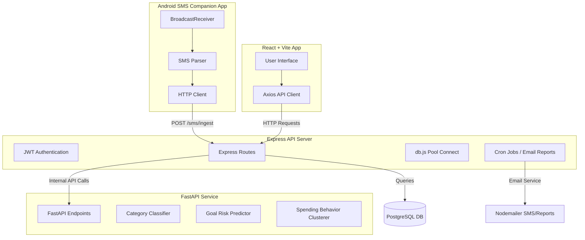

# SmartPay 💳

SmartPay is a smart, AI-powered financial management and payment recommendation system. It provides real-time transaction tracking, automated SMS ingestion, predictive budget risk alerts, and personalized credit card offer recommendations based on spending behavior.

---

## 👥 The Team & Roles

| Developer | Role | Component | Primary Tech Stack |
| :--- | :--- | :--- | :--- |
| **Sejal Jain** | Backend Developer | [Backend](file:///c:/Users/Sejal%20Jain/OneDrive/Documents/web_mini_project/smartpay/Backend) | Node.js, Express, PostgreSQL, Node-cron, Nodemailer |
| **Kanya Ajmera** | Frontend Developer | [Frontend](file:///c:/Users/Sejal%20Jain/OneDrive/Documents/web_mini_project/smartpay/Frontend/Frontend/Frontend) | React, Vite, Tailwind CSS, Axios |
| **Kashish Rathod** | ML Engineer | [ML Services](file:///c:/Users/Sejal%20Jain/OneDrive/Documents/web_mini_project/smartpay/ML_Services1/ML_Services) | Python, FastAPI, Scikit-learn, Joblib |
| **Muskan Ranka** | Android Developer | Android SMS App | Java/Kotlin, Android SDK, BroadcastReceiver, HTTP Client |

---

## 🏗️ System Architecture



---

## 📂 Project Directory Structure

```text
smartpay/
├── Backend/                      # Node.js + Express backend (Sejal Jain)
│   ├── middleware/               # Auth & security middleware
│   ├── migrations/               # Database schema updates
│   ├── routes/                   # API routes (Auth, SMS, Goals, Cards, etc.)
│   ├── services/                 # Business logic, Cron tasks, Chat, ML integrations
│   ├── sql/                      # SQL schema files & database scripts
│   ├── utils/                    # Email and formatting utilities
│   ├── index.js                  # App entry point
│   └── package.json
│
├── Frontend/
│   └── Frontend/Frontend/        # React + Vite application (Kanya Ajmera)
│       ├── src/
│       │   ├── components/       # Shared UI components
│       │   ├── pages/            # View pages (Login, SignUp, Dashboard, etc.)
│       │   ├── services/         # Axios API wrapper (api.js)
│       │   ├── main.jsx          # Entry script
│       │   └── index.css         # Styling directives
│       ├── public/               # Public assets
│       ├── index.html
│       └── package.json
│
└── ML_Services1/
    └── ML_Services/              # FastAPI ML Service (Kashish Rathod)
        ├── data/                 # Datasets used for training models
        ├── models/               # Saved pickle models (.pkl)
        ├── app.py                # FastAPI endpoints
        └── train_*.py            # Training scripts for predictions/clustering
```

---

## 🚀 Setup & Launch Instructions

### 1. 🔌 Backend Setup (Sejal Jain)

1. Open your terminal and navigate to the backend directory:
   ```bash
   cd Backend
   ```
2. Install the Node.js packages:
   ```bash
   npm install
   ```
3. Set up your `.env` file in the `Backend/` directory with the following variables:
   ```env
   PORT=3000
   DATABASE_URL=your_postgresql_connection_string
   JWT_SECRET=your_jwt_secret
   GEMINI_API_KEY=your_gemini_api_key
   EMAIL_USER=your_nodemailer_email
   EMAIL_PASS=your_nodemailer_password
   ML_SERVICE_URL=http://localhost:8000
   ```
4. Run the database seed script to populate default credit card offers:
   ```bash
   node seed_offers.js
   ```
5. Start the backend developer server (runs on `http://localhost:3000`):
   ```bash
   npm run dev
   ```

---

### 2. 🎨 Frontend Setup (Kanya Ajmera)

1. Navigate to the nested React application directory:
   ```bash
   cd Frontend/Frontend/Frontend
   ```
2. Install dependencies:
   ```bash
   npm install
   ```
3. Configure your `.env` file in `Frontend/Frontend/Frontend/` with your backend URL:
   ```env
   VITE_API_BASE_URL=http://localhost:3000
   ```
4. Start the Vite React development server:
   ```bash
   npm run dev
   ```

---

### 3. 🤖 ML Services Setup (Kashish Rathod)

1. Navigate to the ML services directory:
   ```bash
   cd ML_Services1/ML_Services
   ```
2. Set up a Python virtual environment:
   ```bash
   python -m venv venv
   ```
3. Activate the virtual environment:
   - **Windows PowerShell**:
     ```powershell
     .\venv\Scripts\Activate.ps1
     ```
   - **Git Bash / macOS**:
     ```bash
     source venv/bin/activate
     ```
4. Install python dependencies:
   ```bash
   pip install -r requirements.txt
   ```
5. (Optional) Run training scripts if models need to be updated:
   ```bash
   python train_category_prediction_model.py
   python train_clustering_model.py
   python train_goal_risk_model.py
   ```
6. Launch the FastAPI service (runs on `http://localhost:8000`):
   ```bash
    uvicorn app:app --reload
   ```

---

### 4. 📱 Android SMS App Setup (Muskan Ranka)

1. The Android companion app is a Kotlin/Java based application that runs on the user's mobile device.
2. It registers a `BroadcastReceiver` to listen for incoming transaction SMS alerts from banks.
3. Configure the base server API URL in the Android app configuration (e.g., `gradle.properties` or a configuration file) to point to the backend's ingest endpoint:
   ```text
   BACKEND_SMS_INGEST_URL=http://<YOUR_BACKEND_IP>:3000/sms/ingest
   ```
4. Build and deploy the application to your Android device using Android Studio.
5. Grant the necessary `RECEIVE_SMS` and `READ_SMS` runtime permissions when prompted on the device.

---

## 📡 Core API Services Flow

- **Transaction Categorization**: When a transaction is added or ingested from an SMS text, the Backend forwards the transaction message to the FastAPI server at `/predict-category`. The ML Classifier model maps it to categories like `shopping`, `dining`, `travel`, `general`, etc.
- **Budget Goal Risk Assessment**: When users request insights into their goals, the Backend polls the `/predict-goal-risk` endpoint on the FastAPI server, feeding in parameters such as `avg_daily_spend`, `days_remaining`, and `goal_amount`.
- **Spending Behavior Clustering**: The frontend gathers transaction category averages, and the backend forwards them to `/cluster-user` to assign the user a cluster label (e.g., "Frugal Spender", "Dining-Heavy", etc.).
